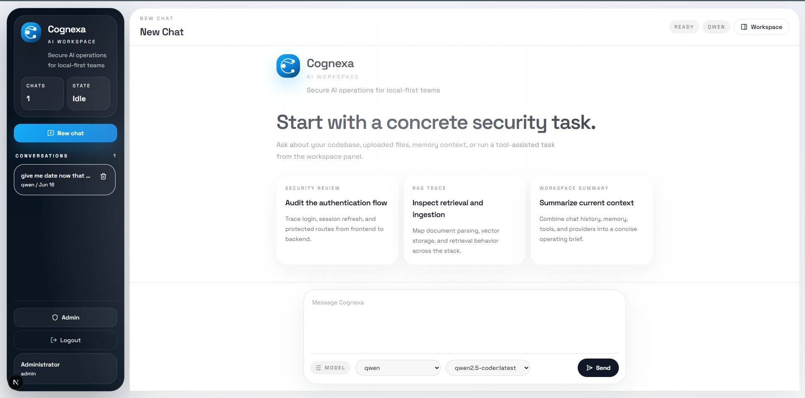
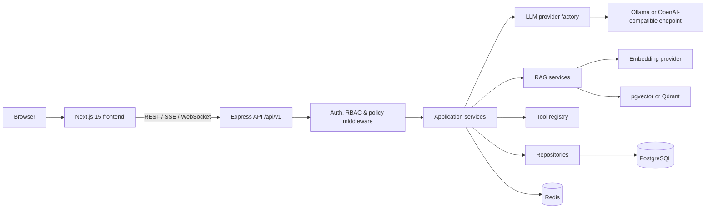

# Cognexa

> A self-hosted AI assistant platform using LLMs, RAG, vector search, and a scalable TypeScript backend architecture.

Cognexa is a local-first workspace for engineering and security teams that need an AI assistant they can run on infrastructure they control. It combines streamed chat, document-grounded answers, memory, structured agent tasks, and governed tool execution behind a Next.js application and an Express API.

The repository also includes admin-only defensive security workflows. Passive website review and authorized, read-only testing are protected by role-based access, policy checks, ownership verification, scope controls, and audit records. These workflows are for systems you own or are explicitly authorized to assess.



## Why Cognexa

- **Self-hosted by design:** use local Ollama-compatible model and embedding endpoints instead of sending workspace data to a hosted assistant by default.
- **Grounded responses:** ingest `.txt`, `.pdf`, and `.docx` documents, create embeddings, and retrieve relevant context with PostgreSQL `pgvector` or optional Qdrant.
- **Modular AI infrastructure:** LLM providers, embedding providers, vector stores, tools, policies, and repositories are separated behind explicit interfaces.
- **Governed operations:** JWT authentication, workspace-aware RBAC, policy evaluation, audit logs, and bounded tool/security workflows are implemented in the backend.

## Features

- Streaming multi-conversation chat with selectable providers and models
- RAG ingestion, chunking, embeddings, retrieval, and document context
- Workspace-scoped memory, conversations, files, agents, tasks, and tools
- Pluggable LLM providers for Qwen, Llama, Mistral, Gemma, and generic OpenAI-compatible endpoints
- `pgvector` as the default vector store; optional Qdrant vector-store implementation
- PostgreSQL migrations and Redis-backed refresh-token and authorization caching
- Admin console for policy administration, endpoint/network visibility, Private Mode, and security review workflows
- Passive website scanning and authorized, read-only testing for verified targets, with guardrails and audit trails

## Architecture



The backend follows a pragmatic layered design:

| Layer | Responsibility | Examples |
| --- | --- | --- |
| API | Routes, controllers, validation, and middleware | `backend/src/api` |
| Services | Application workflows and policy enforcement | `backend/src/services` |
| Domain integrations | LLM, RAG, agent, and tool contracts/implementations | `backend/src/llm`, `rag`, `tools`, `agent` |
| Persistence | Entities, repositories, migrations, PostgreSQL, Redis | `backend/src/database` |
| UI | Workspace, authentication, and admin surfaces | `frontend/app`, `frontend/components` |

### Data flow

1. The frontend authenticates against the API and includes an access token plus workspace context.
2. Middleware resolves the actor, workspace permissions, and applicable policy before a protected action reaches a controller.
3. A controller delegates to a service; services coordinate repositories, LLM/RAG adapters, and tool implementations.
4. PostgreSQL persists application data and embeddings; Redis stores refresh-token state and authorization cache entries.
5. The API returns JSON, streamed chat events, or WebSocket updates to the frontend.

### AI and RAG pipeline

```text
Upload (.txt/.pdf/.docx)
  -> parse document -> chunk text -> create embeddings
  -> store vectors (pgvector by default, Qdrant optional)

Chat request
  -> authenticate + authorize + policy check
  -> embed query -> similarity retrieval -> bounded context
  -> selected LLM provider -> streamed response + persisted message
```

When an agent task invokes a tool, the agent executor uses the tool registry and policy-aware service layer rather than calling tool implementations directly. Provider selection is likewise routed through `ProviderFactory`, allowing model-family implementations to share a stable backend contract.

### Deployment architecture

Docker Compose provisions PostgreSQL with `pgvector`, Redis, Ollama, the Express backend, the Next.js frontend, and a locally bound MeshCentral service. Health checks order backend startup after PostgreSQL, Redis, and Ollama, then frontend startup after the backend health endpoint is available.

For a production deployment, terminate TLS at a reverse proxy, supply secrets through your deployment secret manager, use managed/persistent database backups, and run more than one backend instance only after replacing the current process-local coordination paths with shared infrastructure. See [deployment notes](docs/deployment.md).

## Technology stack

| Area | Technologies present in this repository |
| --- | --- |
| Frontend | Next.js 15, React 19, TypeScript, Tailwind CSS |
| Backend | Node.js, Express 5, TypeScript, Zod |
| AI | Ollama-compatible API, Qwen/Llama/Mistral/Gemma providers |
| Retrieval | PostgreSQL, `pgvector`, optional Qdrant, document chunking and embeddings |
| Runtime | Redis, Pino, Docker Compose |
| Security | Helmet, CORS, JWT access/refresh tokens, bcrypt, RBAC, policy/audit services |
| Testing | Node test runner via `tsx --test` with backend unit and route tests |

## Repository layout

```text
.
├── frontend/                 # Next.js UI, components, API proxy routes, middleware
├── backend/
│   ├── src/api/              # Express routes, controllers, middleware
│   ├── src/services/         # Application workflows
│   ├── src/llm/              # Provider abstractions and implementations
│   ├── src/rag/              # Parsing, chunking, embeddings, retrieval, vector stores
│   ├── src/database/         # Entities, repositories, migrations, PostgreSQL, Redis
│   ├── src/tools/            # Tool contracts, registry, implementations
│   └── test/                 # Backend test suite
├── docker/                   # Backend/frontend images and PostgreSQL bootstrap SQL
├── docs/                     # Architecture, deployment, HTTPS, and policy documentation
├── scripts/                  # Local HTTPS, development, and Windows helper scripts
├── agents/                   # Agent notes and profiles
├── memory/                   # Memory design notes
├── rag/                      # Retrieval design notes
└── tools/                    # Tool catalog and contracts
```

## Installation

### Prerequisites

- Node.js compatible with the repository dependencies
- PostgreSQL with `pgvector` (or Docker)
- Ollama for the default local model/embedding runtime
- Redis, unless using the local `memory://local` development mode

### Local development

```bash
git clone https://github.com/coldworld22/Cognexa-security-ai-lab.git
cd Cognexa-security-ai-lab
npm ci
```

Create local configuration files:

```bash
cp .env.example .env
cp backend/.env.example backend/.env
cp frontend/.env.example.local frontend/.env.local
```

On PowerShell, use `Copy-Item` instead of `cp`. Before starting the application, replace all example credentials and set a strong `JWT_SECRET`, `JWT_REFRESH_SECRET`, and `ADMIN_PASSWORD` in `backend/.env`.

Pull the default local models and generate development certificates:

```bash
ollama pull qwen2.5-coder
ollama pull nomic-embed-text
npm run certs:dev
```

Start PostgreSQL locally, configure `POSTGRES_URL`, then run the applications in separate terminals:

```bash
npm run dev:backend
npm run dev:frontend
```

The default HTTPS endpoints are `https://localhost:3000` and `https://localhost:5000/health`. For the HTTP development launchers, use `npm run dev:backend:http` and `npm run dev:frontend:http`. See [local HTTPS instructions](docs/local-https.md).

### Verify locally

```bash
npm run typecheck
npm run build
npm run test --workspace @security-ai-lab/backend
```

## Docker deployment

Start the complete development stack:

```bash
docker compose up --build
```

Or start its core dependencies first:

```bash
docker compose up -d postgres redis ollama
docker exec security-ai-lab-ollama ollama pull qwen2.5-coder
docker exec security-ai-lab-ollama ollama pull nomic-embed-text
```

The Compose file currently includes development defaults, including placeholder JWT secrets and development-oriented verification settings. Do **not** expose that configuration publicly. For any non-local deployment, override secrets and environment values, remove verification bypasses, set `NODE_ENV=production`, and place the services behind TLS termination.

## Environment configuration

Configuration templates live at [`.env.example`](.env.example), [`backend/.env.example`](backend/.env.example), and [`frontend/.env.example.local`](frontend/.env.example.local).

| Variable group | Purpose |
| --- | --- |
| `POSTGRES_URL`, `REDIS_URL` | Application persistence and runtime state. `memory://local` is development-only Redis fallback. |
| `JWT_SECRET`, `JWT_REFRESH_SECRET` | Access/refresh-token signing secrets; supply unique high-entropy values. |
| `DEFAULT_LLM_*`, `LOCAL_MODEL_BASE_URL` | Default model/provider and LLM endpoint. |
| `DEFAULT_EMBEDDING_MODEL`, `LOCAL_EMBEDDING_BASE_URL`, `EMBEDDING_DIMENSION` | Embedding runtime and vector dimensions. |
| `QDRANT_URL` | Optional Qdrant endpoint; `pgvector` is the default implementation. |
| `HTTPS_*`, `FORCE_HTTPS`, `TRUST_PROXY` | HTTPS behavior and reverse-proxy configuration. |
| `ADMIN_*`, `AUTHORIZED_TESTING_*`, `ENABLE_VERIFICATION_BYPASS` | Administrative access and safety boundaries; keep bypasses disabled outside development. |

## API overview

The API is mounted at `/api/v1`; `/health` reports service health. Route groups include:

| Group | Representative capabilities |
| --- | --- |
| `/auth` | Login, refresh, session, preferences |
| `/workspaces` | Workspace selection and membership/invitations |
| `/chat` | Conversations, messages, and streaming responses |
| `/rag`, `/memory`, `/llm`, `/tools`, `/agents` | Knowledge retrieval, memory, providers, tool catalog, and tasks |
| `/endpoints`, `/admin` | Admin monitoring, policies, Private Mode, scanning, and authorized testing |

The repository does not currently publish a versioned OpenAPI specification. Treat the route definitions in `backend/src/api/routes` and controllers as the source of truth until one is added.

## Screenshots

The current chat-workspace screenshot is shown above. Add curated, redacted screenshots under `docs/images/` for the workspace, document ingestion/RAG trace, and admin/policy views before a public release. Never publish customer data, tokens, hostnames, or security findings in screenshots.

## Security and operational boundaries

- Security review is passive and defensive.
- Authorized testing requires verified public-domain ownership (with tightly scoped development exceptions) and is restricted to read-only request methods and same-origin scope.
- The project has policy and authorization enforcement, but it is not yet documented as a production security certification or compliance framework.
- Do not commit `.env` files, runtime directories, database data, certificates, logs, uploads, or generated build output.

## Roadmap

The following are future improvements, not claims about the current implementation:

- [ ] Publish an OpenAPI contract and generated API reference
- [ ] Add root-level CI for type checks, builds, tests, linting, and dependency/security scanning
- [ ] Add integration tests against disposable PostgreSQL/Redis and end-to-end browser tests
- [ ] Replace process-local agent/event coordination with durable queues and shared pub/sub for multi-instance deployments
- [ ] Add production Compose/Helm deployment examples with secret-manager integration and reverse-proxy configuration
- [ ] Publish model/provider compatibility, RAG evaluation, and performance benchmarks
- [ ] Add redacted screenshots, demo data, release notes, and a project changelog

## Contributing

Contributions are welcome. Until dedicated contributor documents are added, please:

1. Open an issue describing the problem or proposed change before substantial work.
2. Keep changes focused and preserve service, repository, and adapter boundaries.
3. Add or update backend tests for behavior changes.
4. Run `npm run typecheck`, `npm run build`, and `npm run test --workspace @security-ai-lab/backend` before opening a pull request.
5. Do not include credentials, runtime data, target details, or unredacted security findings in commits, issues, or screenshots.

Planned community files: `CONTRIBUTING.md`, `CODE_OF_CONDUCT.md`, `SECURITY.md`, issue templates, and pull-request templates.

## Documentation

- [Architecture](docs/architecture.md)
- [Deployment](docs/deployment.md)
- [Local HTTPS](docs/local-https.md)
- [Policy engine](docs/policy-engine.md)

## License

The backend package declares the MIT license. Add a root-level [`LICENSE`](LICENSE) file before representing the repository as an open-source project or accepting external contributions.
