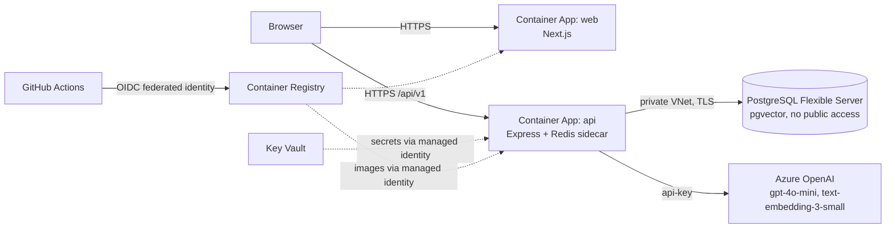

# Running Cognexa on Azure

Cognexa runs fully local by default, with Ollama models and no data leaving your machines. This guide
covers the other option: hosting it on Azure with **Azure OpenAI** models, provisioned entirely with
Terraform in [`infra/azure`](../infra/azure).

## Architecture



| Piece | Choice | Why |
|---|---|---|
| Compute | Azure Container Apps (Consumption) | Containers without managing a cluster; the web app scales to zero when idle. |
| Models | Azure OpenAI `gpt-4o-mini` and `text-embedding-3-small` | Cognexa's providers already speak the OpenAI API; Azure's v1 endpoint is the same format, so it's one small provider class. |
| Vectors | PostgreSQL Flexible Server with **pgvector** | Same store as local, so RAG code doesn't change. Embeddings are requested at 768 dimensions to fit the existing column. |
| Network | VNet with delegated subnets and a private DNS zone | The database has **no public endpoint**; only the apps inside the VNet can reach it. |
| Secrets | Key Vault with RBAC, read by a **user-assigned managed identity** | No secret appears in app settings, Terraform outputs or GitHub. Terraform generates every password. |
| Images | Azure Container Registry, admin user disabled | Apps pull with their managed identity (`AcrPull`). |
| CI/CD | GitHub Actions with a **federated identity credential** | No client secret exists. Only `main` of this repository can deploy, and only to the two apps. |
| Logs | Log Analytics workspace | Container logs and metrics in one place. |

## Deploy

You need an Azure subscription where Azure OpenAI is enabled, plus the Azure CLI and Terraform.

```bash
az login
cd infra/azure
cp terraform.tfvars.example terraform.tfvars
terraform init
terraform apply
```

Then in GitHub (Settings → Secrets and variables → Actions → **Variables**), add these from the
Terraform outputs: `AZURE_CLIENT_ID`, `AZURE_TENANT_ID`, `AZURE_SUBSCRIPTION_ID`, `AZURE_ACR_NAME`
and `AZURE_RESOURCE_GROUP`. Run **Deploy to Azure Container Apps** from the Actions tab. It builds
both images, deploys the API, then builds the web app with the API's address baked in.

The admin password is generated by Terraform and stored in Key Vault:

```bash
az keyvault secret show --vault-name "$(terraform output -raw admin_password_secret)" --name admin-password --query value -o tsv
```

## Using Azure OpenAI without Azure hosting

You can point a local Cognexa at Azure OpenAI with environment variables only:

```bash
DEFAULT_LLM_PROVIDER=azure-openai
AZURE_OPENAI_ENDPOINT=https://<resource>.openai.azure.com
AZURE_OPENAI_API_KEY=<key>
AZURE_OPENAI_CHAT_DEPLOYMENTS=gpt-4o-mini,gpt-4o
EMBEDDING_PROVIDER=azure-openai
AZURE_OPENAI_EMBEDDING_DEPLOYMENT=text-embedding-3-small
```

Azure deployments then appear next to the local models in the model picker.

## Trade-offs to know about

- **Redis is a sidecar**, not Azure Cache for Redis, to keep a demo cheap. It holds refresh tokens and
  the authorization cache, so the API runs exactly one replica and a restart signs users out. For
  production, switch `REDIS_URL` to Azure Cache for Redis and raise `max_replicas`.
- **The web app and API have separate addresses.** For production, put both behind Azure Front Door on
  one custom domain, which also keeps cookies first-party.
- **Data residency:** the app, database and vault default to UAE North, the closest Azure region to
  Saudi Arabia. Azure OpenAI defaults to Sweden Central because model availability differs by region.
  Prompts and documents sent to the model leave the UAE. Choose `openai_location` accordingly, or keep
  using the local models for sensitive data.
- **API key for Azure OpenAI.** The key lives in Key Vault and reaches the app as a secret reference.
  Switching to Entra ID tokens from the managed identity would remove the key entirely; it needs the
  `@azure/identity` package and is the natural next step.

**Cost:** roughly 30–50 USD a month at idle. That's mostly the PostgreSQL `B1ms` server and the API's
always-on replica. Model usage is billed per token on top. Run `terraform destroy` to remove everything.
